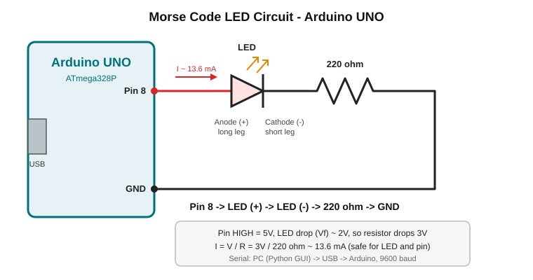

# Morse Code Communication System (Arduino + Python)

A Tkinter GUI sends Morse symbols (`.` and `-`) over USB serial to an Arduino UNO, which blinks an LED with the matching timing. Python also decodes the typed pattern into a letter.

Blog posts:
- [Build Your Own Morse Code System Using Arduino & Python](https://medium.com/@sakshisonone10/build-your-own-morse-code-system-using-arduino-python-2fded14e8589)
- [Designing a Morse Code Communication System Using Arduino and Python](https://medium.com/@sakshisonone10/designing-a-morse-code-communication-system-using-arduino-and-python-a3f93dffe0cb)

## Data flow

```
Button click -> Python sends '.' or '-' -> Serial (9600 baud) -> Arduino -> LED blink
```

## Components

- Arduino UNO
- Breadboard
- 1 x LED (any colour)
- 1 x 220 ohm resistor
- Jumper wires, USB cable

## Wiring



```
Arduino Pin 8 --> LED anode (+, long leg)
LED cathode (-, short leg) --> 220 ohm resistor --> Arduino GND
```

Resistor current: (5V - 2V) / 220 ohm ~ 13.6 mA, safe for the LED and the pin.

Don't want to wire anything? Set `LED_PIN = 13` in the sketch to use the on-board LED.

## Setup

1. Open `arduino/morse_receiver/morse_receiver.ino` in the Arduino IDE and upload it to the board.
2. Install the Python dependency: `pip install -r python/requirements.txt`
3. Find your port (Arduino IDE -> Tools -> Port): `COM3` on Windows, `/dev/ttyACM0` or `/dev/ttyUSB0` on Linux, `/dev/cu.usbmodem*` on Mac.
4. Close the Arduino Serial Monitor (it blocks the port), then run:
   ```
   python python/morse_gui.py COM3
   ```

## Test it

Click Dot x3, Dash x3, Dot x3 -> the LED blinks `... --- ...` (SOS). Click **Decode Letter** after each letter's pattern to see it in the terminal.

## Timing

| Symbol | LED ON | Gap after |
|--------|--------|-----------|
| Dot    | 200 ms | 200 ms    |
| Dash   | 600 ms | 200 ms    |

## Ideas to extend

- Text-to-Morse converter
- Buzzer for sound playback
- Wireless Morse signalling
- Decoded-text display inside the GUI
